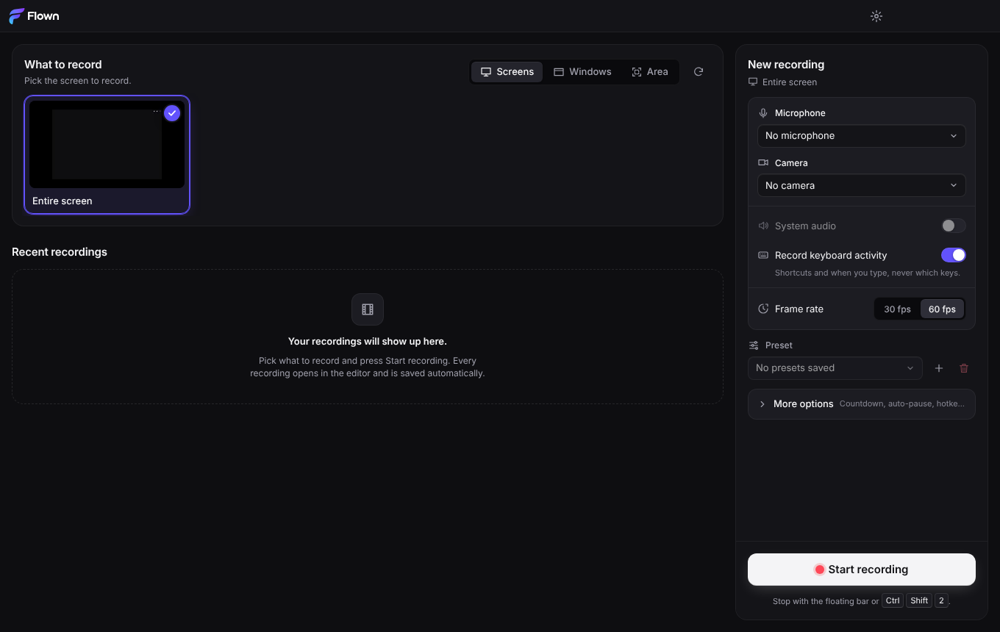
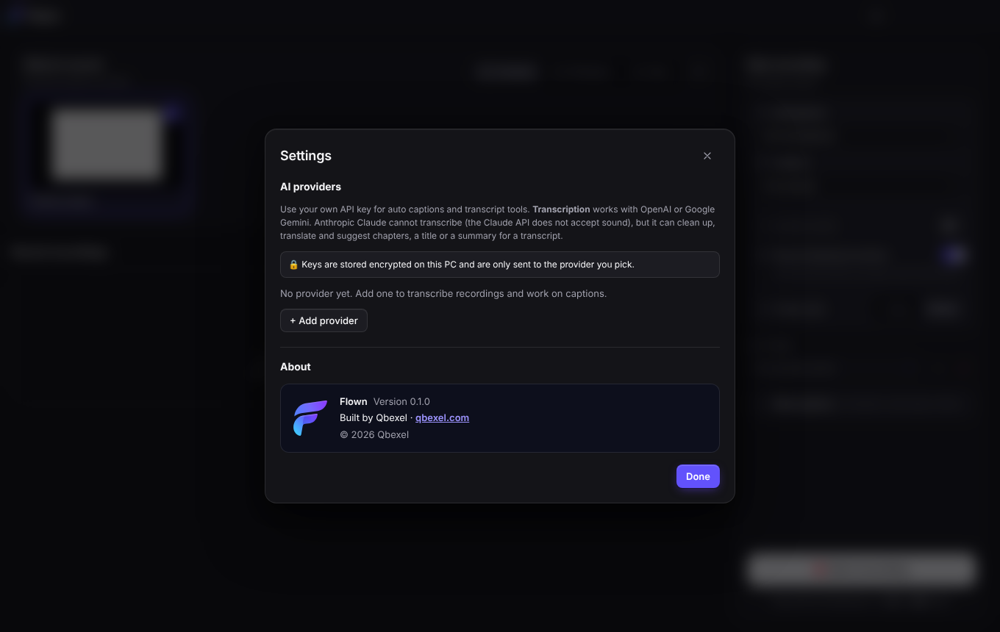

# Rebrand: Screen Studio for Windows → Flown by Qbexel

Branch `feat-flown-rebrand`, on top of `48ed9a7`. The app is now **Flown**, built by **Qbexel**
(<https://qbexel.com>), with the icons and logo from Qbexel's Flown brand kit.

| Home | Settings › About |
| --- | --- |
|  |  |

(`docs/screenshots/brand-home.png` 79 KB and `brand-about.png` 123 KB, taken by
`tests/e2e/brand.e2e.cjs` with `SSW_BRAND_SHOTS=<dir>`, on Xvfb, which draws no Windows caption
buttons.)

## What was renamed

| Where | Before | Now |
| --- | --- | --- |
| `package.json` | `windows-screen-studio`, productName "Screen Studio for Windows", author `samiulakhan12` | `flown`, productName "Flown", `author: { name: "Qbexel", url: "https://qbexel.com" }`, `homepage: "https://qbexel.com"`, new description; lockfile name too |
| electron-builder | appId `com.samiulakhan12.screenstudio`, `Screen Studio for Windows.exe`, `ScreenStudio-Setup-<v>.exe` | appId `com.qbexel.flown`, `executableName: Flown` → `Flown.exe`, `Flown-Setup-<v>.exe`, shortcuts `Flown`, `uninstallDisplayName: Flown`, `copyright: "Copyright © 2026 Qbexel"` |
| Windows file properties | — | electron-builder writes them from the above: CompanyName = `author.name`, FileDescription/ProductName = productName, LegalCopyright = `copyright` (app exe via rcedit; the installer via `VIAddVersionKey`) |
| Window titles | `Screen Studio for Windows` (BrowserWindow and `index.html`, so also the toolbar and region-picker windows) | `Flown` |
| Home title bar | gradient square + "Screen Studio *for Windows*" text | the kit's mark (flat variant, 22 px) + white wordmark, as SVG (`components/BrandLogo.tsx`), crisp at any scale |
| Messages | "Please reinstall Screen Studio for Windows", "…allow Screen Studio for Windows…", "Screen Studio for Windows stopped unexpectedly and was reloaded.", the warning and quit dialogs' title | "Flown" in each |
| Source list | hid windows named "Screen Studio for Windows" | hides windows named "Flown" |
| AppUserModelID | `com.samiulakhan12.screenstudio` | `com.qbexel.flown` (= appId; `src/shared/brand.ts`, a unit test checks the two match) |
| Recordings folder | `Videos\Screen Studio for Windows` | `Videos\Flown` (migrated, see below) |
| userData | `%APPDATA%\Screen Studio for Windows` | `%APPDATA%\Flown` (migrated) |
| Native helper text | `--help`, Cargo description | "Flown" |
| Docs | README (title, intro, installer name, recordings path, research link), BUILDING.md (installer name, exe name, icon section, verify-dist, signing examples, new "Upgrading" section), IMPLEMENTATION.md (data folders and migration), native/README.md | |

A grep for `screen studio` (any case) over `src`, `tests`, `docs`, `README.md`, `scripts`,
`electron-builder.config.cjs` and `package.json` now finds only: the credit in `docs/RESEARCH.md`
(kept as a plain reference), and the old name where the migration and the upgrade need it
(`LEGACY_APP_NAME` in `src/shared/brand.ts`, `build/installer.nsh`, the comments and tests about
them, BUILDING.md's upgrade section, the GUID comment).

### Kept on purpose (users never see them)

- `SSW_*` environment variables (test hooks and build switches such as `SSW_REQUIRE_SIGNING`):
  renaming them would break CI and developer setups for no user benefit.
- The `studio-media://` scheme: internal URL scheme in the CSP and the media protocol.
- `ssw-capture.exe`: the native helper's file name; the packaging, the Rust crate and its tests
  depend on it. Only its help text changed.
- CSS class names (`.brand`, `.brand-mark`, …), the `ssw:open-settings` event name, the
  `StudioApi` type: code identifiers. `.brand-mark`'s rules in `styles.css` are now unused; I left
  them because another engineer is editing `styles.css` (one line to delete later).
- The export temp-file prefix `screen-studio-gif-*` (system temp folder): the start-up sweep
  matches that prefix, so renaming it would leave files from older versions behind.
- The "Studio" style preset and the "Studio" export quality: feature names, not the brand.
- The repository name `windows-screen-studio`.
- Older screenshots in `docs/screenshots/` (`home.png`, …) still show the old title bar; another
  engineer is adding the README Screenshots section, so I did not retake them.
- No ffmpeg licence note was added to About: the app shows none anywhere today (the GPL texts ship
  next to `ffmpeg.exe`, checked by verify-dist).

## Icons and logo

From `riadkhan60/new-folder--3-` @ `ccr-756bb772-w087yq`, `flown-brand/` (cloned read-only outside
the repo; only SVG files copied, no scripts run). Masters in `assets/brand/` with `BRAND.md`
(colours and the kit's usage rules):

| Kit file | Used for |
| --- | --- |
| `app-icon/svg/flown-app-icon.svg` | `build/icon.ico` 48, 64, 96, 128, 256 px and `build/icon.png` (512) |
| `app-icon/svg/flown-app-icon-small.svg` | `build/icon.ico` 16, 20, 24, 32, 40 px (the kit says: below 48 px use the small art) |
| `logo/svg/flown-mark-flat.svg` + `flown-wordmark-white.svg` | Home title bar (mark < 48 px → flat art) |
| `logo/svg/flown-mark.svg` | About (48 px), installer sidebar |

The kit's `Flown.ico` already has 16–256 px (16, 20, 24, 32, 40, 48, 64, 96, 128, 256, all PNG).
I regenerated `build/icon.ico` from the SVG masters with the existing pipeline instead of copying
it, so `npm run icons` reproduces the committed files byte for byte (checked: two runs, identical
MD5s), with the same sizes as the kit and classic DIB entries below 256 px (readable by every
Windows consumer). `build/installer-sidebar.svg` is new art (Ink background, mark, wordmark) for
the installer's welcome/finish page. The old `build/icon.svg` / `icon-small.svg` are deleted. The
same `build/icon.ico` is the exe, installer, uninstaller, shortcut and (dev) window icon; verify-dist
checks the exe and the installer carry it and that it has every size from 16 to 256.

## Colours

`src/renderer/src/styles.css`, token values only (two small hunks inside `:root`):

| Token | Before | Now | Contrast |
| --- | --- | --- | --- |
| `--accent-500` | `#6d4aff` | `#6252fc` (Flown Indigo) | white text 5.1:1 |
| `--accent-400` (primary hover) | `#7d5fff` | `#6b5dfd` | white text 4.6:1 (was 4.2:1) |
| `--accent-600` | `#5d3ef0` | `#5443ec` | white text 6.2:1 |
| `--accent-text` | `#a99bff` | `#9d94ff` | 7.1:1 on surface-1, 6.0:1 on surface-3 |
| `--accent-soft/-softer/-ring` | violet rgba | indigo rgba | — |
| `--accent-gradient` | violet → pink | `#3fcbff → #4d9bff → #6252fc → #8b3aff` | only behind non-text (progress bars) |
| `--record` | `#ef4444` | `#ff4757` (Flown Record) | 5.5:1 on surface-1; used for dots and the stop button |

## About

- `src/renderer/src/settings/AboutSection.tsx` + `about.css` (new files): Flown mark, "Flown",
  "Version 0.1.0" (from `app.getVersion()` over `brand:app-info`), "Built by Qbexel · qbexel.com",
  "© 2026 Qbexel". Registered in `SettingsDialog.tsx` with three lines (import, section type,
  `<AboutSection />`) and one line in `SettingsButton.tsx` (accepts `section: 'about'`).
- The link calls `window.api.openCompanyWebsite()`, whose main handler (`src/main/brandIpc.ts`)
  takes no argument and only ever calls `shell.openExternal('https://qbexel.com')`.
- "About Flown" (General) in the command registry: one entry in `commands.ts`, `about: []` in the
  default keymap, one handler in `Editor.tsx` that opens Settings at About.

## Keeping users' data (first start as Flown)

`src/main/brandMigration.ts` (Electron-free, unit-tested on temp folders), run from `index.ts`:

1. **userData**, at the top of the main script, before the single-instance lock (which lives in
   userData) and before anything reads it. Electron creates the new folder *empty* before the
   main script runs (checked with a probe app), so the rule is: if the old folder exists and the
   new one is absent or holds only Chromium's own start-up files (`Singleton*`, `Crashpad`, GPU
   caches), remove the new one and **rename the whole old folder**. Moving the folder keeps
   `Local State` (the DPAPI-wrapped safeStorage key) next to `ai-providers.json`, so saved AI keys
   still decrypt. If the new folder already has settings, it wins and the old one is left alone.
   If the rename fails (a file held open), the app uses the old folder in place
   (`app.setPath('userData', old)`) and tries again next start.
2. **Recordings**, first thing after `ready` (after the lock, so two instances never move them at
   once; before any IPC can list them): if `Videos\Flown` does not exist, one rename of
   `Videos\Screen Studio for Windows`; otherwise entry by entry, a clashing name getting `-2`
   (as `createProjectDir` does), then the emptied old folder is removed. Anything that cannot
   be moved stays and its folder becomes a **legacy root**: `projects.ts` lists every root (ids
   deduplicated, the new root first), `projectDir(id)` resolves an id found only there, and new
   recordings always go to `Videos\Flown`. No recording disappears from the library.

Each step is a single same-volume rename (atomic), so a crash leaves things moved or not and the
next start finishes; running it again is a no-op. Tests: `tests/brandMigration.test.ts`
(11 cases: move, Electron's empty folder, idempotence, keep-new, rename failure → old in place
then moved later, recordings rename/merge/clash/crash-resume/partial failure, and the library
with a legacy root).

## Upgrading an installed "Screen Studio for Windows"

electron-builder derives the NSIS product GUID from the appId
(`UUID.v5(appId, 50e065bc-3134-11e6-9bab-38c9862bdaf3)` in
`app-builder-lib/out/targets/nsis/NsisTarget.js`). A new appId alone would make Flown a second
product beside the old one. So:

- `nsis.guid: '25fa5926-dc93-5490-a32e-c16bd99d39ca'` = UUID v5 of the old appId (the unit test
  recomputes it with `builder-util-runtime`, and the Wine install of the old build below shows
  this exact key). The Flown installer therefore finds the old install, runs its uninstaller with
  `/KEEP_APP_DATA --updated` (which deletes `Screen Studio for Windows.exe` and its Desktop and Start
  menu shortcuts, and keeps `%APPDATA%`), and reuses the same Add/Remove Programs entry.
- `build/installer.nsh`: the old install folder `…\Programs\Screen Studio for Windows` would
  otherwise be reused (silent) or become `…\Screen Studio for Windows\Flown` (the directory page
  appends the app name). `customInit` and a never-shown page before the install step change a
  `$INSTDIR` ending in `\Screen Studio for Windows` to the sibling `\Flown`; a folder the user
  named differently is kept. `customInstall` deletes `Screen Studio for Windows.lnk` from the
  Desktop and Start menu if the old uninstaller left one.
- appId `com.qbexel.flown` is the AppUserModelID electron-builder stamps on the new shortcuts,
  and the app sets the same ID at start, so the running window groups with its shortcut/pin. The
  old ID is not kept: its shortcuts are gone with the old app, and a new ID matches the new
  name. A taskbar pin of the old shortcut goes away with it; users pin Flown again.

Limitations: an interactive upgrade still *shows* the old folder on the directory page (it is
corrected right after it); a silent per-machine upgrade re-reads the old folder after elevation
and installs there (Flown.exe in the old-named folder, still one product). The app's own
migration cannot be exercised under Wine (Electron does not run there); it is covered by the unit
and e2e tests on Linux.

## Verification

All run on this branch in this container (Linux, Node 22.22, Wine 9.0, Xvfb).

| Check | Result |
| --- | --- |
| `npm run typecheck` | pass |
| `npx vitest run --testTimeout=60000` | **115 files, 1480 tests passed** |
| `npm run build` | pass |
| `WINEDEBUG=-all npm run dist:win` | pass: `dist/Flown-Setup-0.1.0.exe` (116.6 MB), `dist/win-unpacked/Flown.exe`; verify-dist "all checks passed" (icon in exe and installer: 16, 20, 24, 32, 40, 48, 64, 96, 128, 256 px; Qbexel metadata) |
| Native helper | not bundled: no MinGW / Windows Rust target here (predist warns, verify-dist notes it); unchanged by this work |
| Upgrade under Wine | old `ScreenStudio-Setup-0.1.0.exe` (built from `48ed9a7`) then `Flown-Setup-0.1.0.exe /S`: see below |
| Full e2e (`xvfb-run -a -s "-screen 0 1920x1080x24" npm run test:e2e`) | 36/39 files passed in the full run (171 PASS lines, including all 5 new brand tests). Failures below |

verify-dist output (excerpt):

```
verify-dist: ok   Flown.exe icon = build/icon.ico (16, 20, 24, 32, 40, 48, 64, 96, 128, 256 px)
verify-dist: ok   Flown-Setup-0.1.0.exe icon = build/icon.ico (16, 20, 24, 32, 40, 48, 64, 96, 128, 256 px)
verify-dist: ok   Flown.exe properties: CompanyName "Qbexel", ProductName "Flown", FileDescription "Flown", LegalCopyright "Copyright © 2026 Qbexel"
verify-dist: ok   Flown-Setup-0.1.0.exe properties: CompanyName "Qbexel", ProductName "Flown", LegalCopyright "Copyright © 2026 Qbexel"
verify-dist: all checks passed.
```

Version resources, read with the new `readVersionStrings()` in `scripts/lib/pe.cjs`:

```
dist/win-unpacked/Flown.exe
  CompanyName      Qbexel
  FileDescription  Flown
  FileVersion      0.1.0
  InternalName     Flown
  LegalCopyright   Copyright © 2026 Qbexel
  ProductName      Flown
  ProductVersion   0.1.0.0
dist/Flown-Setup-0.1.0.exe
  CompanyName      Qbexel
  FileDescription  Screen recorder and editor for Windows by Qbexel: auto zoom, smooth cursor, backgrounds, webcam and one-click export.
  FileVersion      0.1.0
  LegalCopyright   Copyright © 2026 Qbexel
  ProductName      Flown
  ProductVersion   0.1.0
```

(electron-builder sets the installer's FileDescription from `package.json` `description`.)

Upgrade under Wine (fresh prefix; Wine's PowerShell stub answers electron-builder's "is the app
running?" check wrongly, so a real PE that exits 1 stood in for `powershell.exe`):

| | After installing the old build | After installing Flown over it |
| --- | --- | --- |
| `…\AppData\Local\Programs` | `Screen Studio for Windows\Screen Studio for Windows.exe` | `Flown\Flown.exe` (old folder gone) |
| Desktop / Start menu | `Screen Studio for Windows.lnk` | `Flown.lnk` (old `.lnk` gone) |
| `HKCU\…\Uninstall\25fa5926-dc93-5490-a32e-c16bd99d39ca` | "Screen Studio for Windows 0.1.0", Publisher samiulakhan12 | the same key: "Flown", Publisher Qbexel, `…\Programs\Flown\Uninstall Flown.exe` |
| `HKCU\Software\25fa5926-…` | InstallLocation `…\Screen Studio for Windows` | InstallLocation `…\Programs\Flown`, ShortcutName Flown |
| `HKCU\Software\d6395291-…` (GUID of the new appId) | — | absent: no second product |
| `%APPDATA%\Screen Studio for Windows` (user data) | present | kept (the app moves it on first start) |

(Wine's own `Screen Studio for Windows.desktop` Linux launcher stayed on the prefix's Desktop; that
is winemenubuilder's file, not something Windows creates.)

Full e2e run, the three failures:

- `captions.e2e.cjs`: "Generate with no provider, with only Claude, and the error from a provider
  that fails" (`page.click: Timeout 30000ms exceeded`): the known failure at `48ed9a7`, being fixed
  elsewhere. Every other captions test passed.
- `recording-options.e2e.cjs`: "custom hotkeys…" (`first mark at 1.896 (≈ 1.184)`, a timing
  assertion) and `recording.e2e.cjs`: "vanished sources give friendly errors…"
  (`waitForSelector` 120 s timeout). Both are timing-sensitive recording tests that ran while the
  machine was loaded (the Wine upgrade test ran at the same time). Rerun on their own right after
  (`node tests/e2e/run-all.cjs recording-options.e2e recording.e2e`, 3 files matched): **all pass**,
  both of these tests included. Neither touches anything the rebrand changed (hotkey timing, the
  source picker's error path).

### New e2e: `tests/e2e/brand.e2e.cjs`

1. Window titles and Home: every window titled "Flown", the title-bar logo (`role=img`,
   `aria-label="Flown"`, two SVG images loaded, 22 px mark), no "Screen Studio" anywhere on Home.
2. Settings › About: "Built by Qbexel", "Version 0.1.0" (= `app.getVersion()`), "© 2026 Qbexel",
   the `qbexel.com` link; clicking it calls `shell.openExternal('https://qbexel.com')` (stubbed in
   the main process) and the window does not navigate; calling the IPC with another URL still
   opens only qbexel.com.
3. "About Flown" in the editor's command palette opens Settings at About.
4. First start with an old install's `~/.config/Screen Studio for Windows` and
   `~/Videos/Screen Studio for Windows/<recording>`: userData is `~/.config/Flown` with the old
   prefs, the recording is in `~/Videos/Flown`, listed on Home and opens.
5. Recordings in both folders with a clashing id: all three are listed (`rec-a`, `rec-a-2`,
   `rec-b`) and the moved clash opens.

Updated e2e for the rename: `helpers.cjs` (`projectsRoot` → `Videos/Flown`), `audit-security`
(title), `recording-recovery` (message), `packaging` (window icon samples: Ink tile, violet and
cyan blades).
