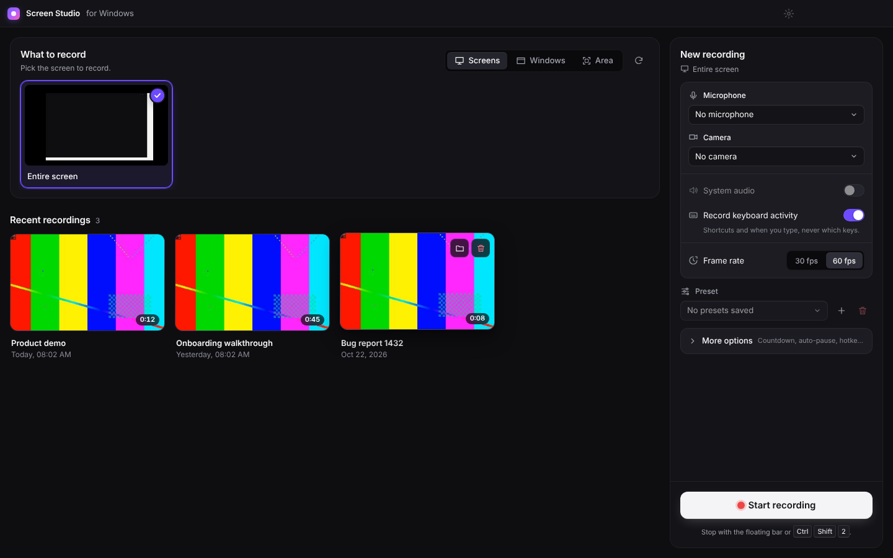
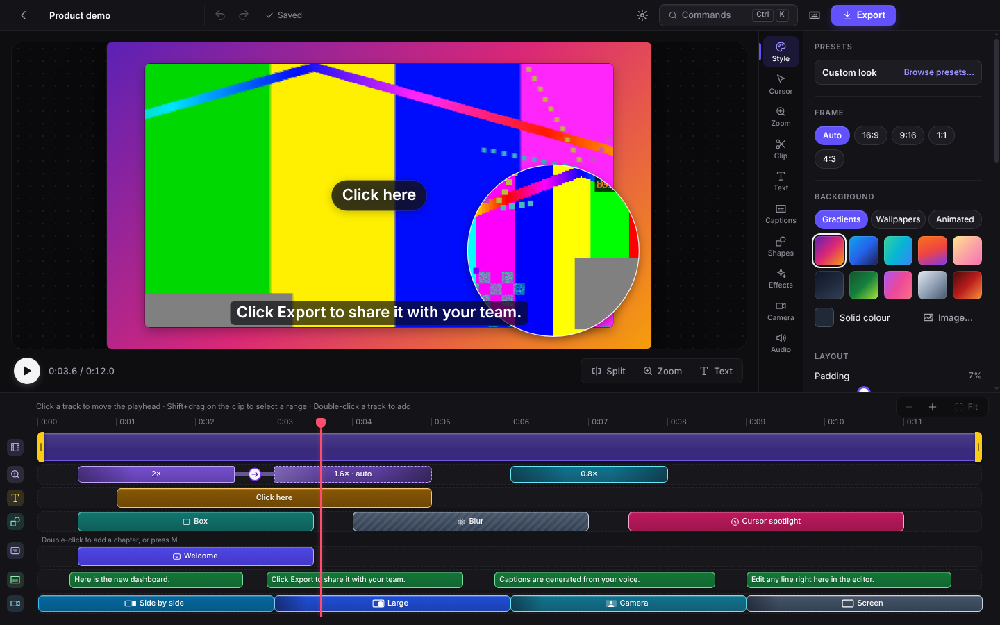
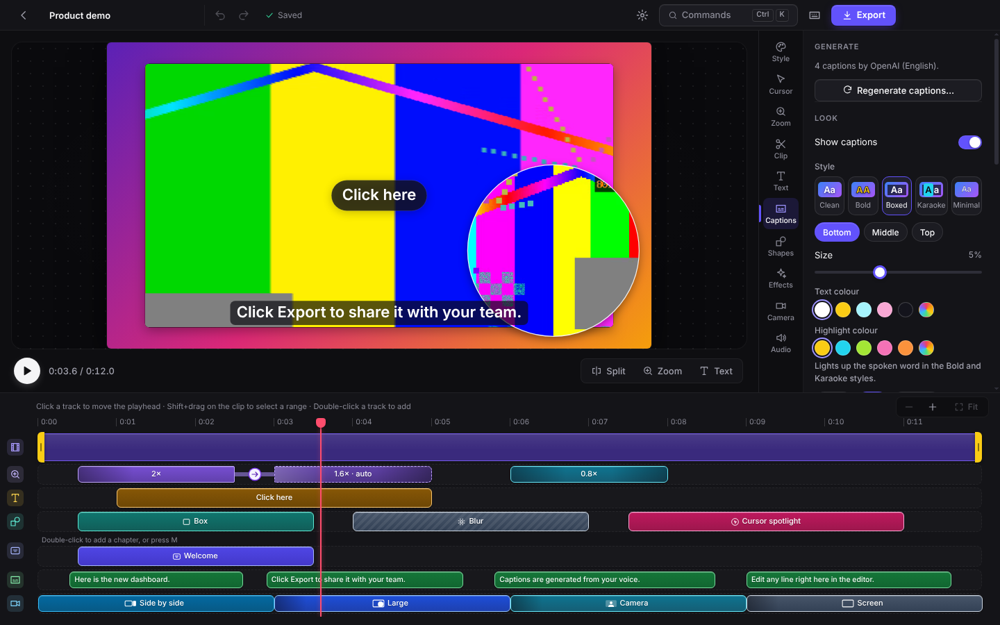
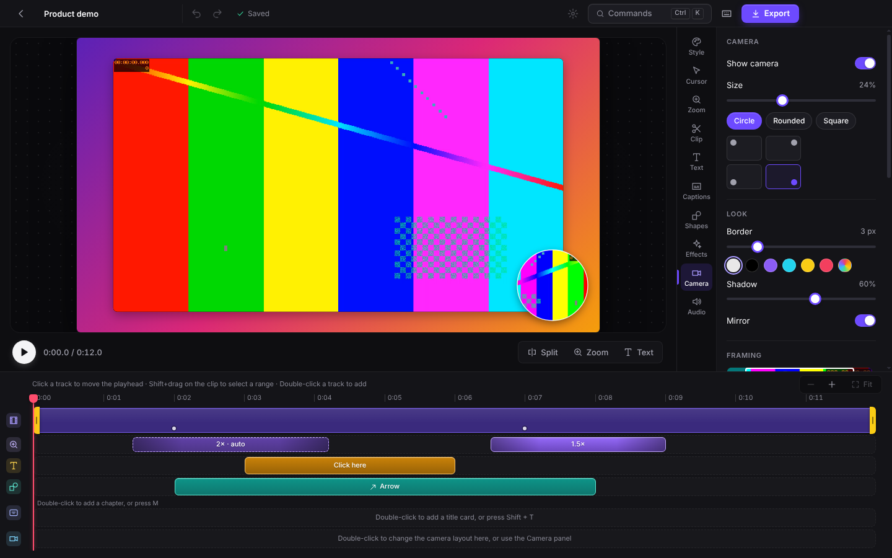
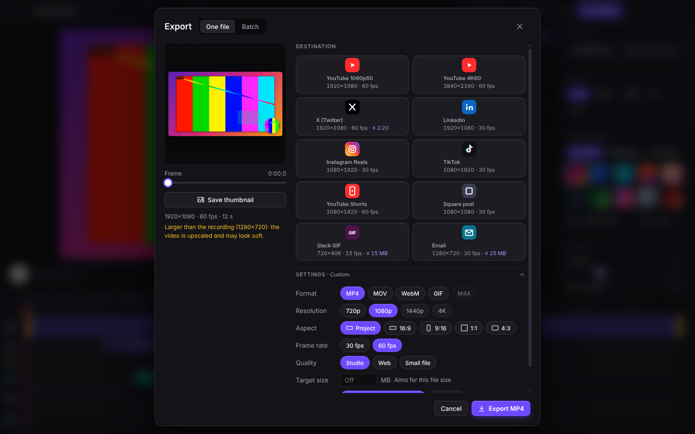
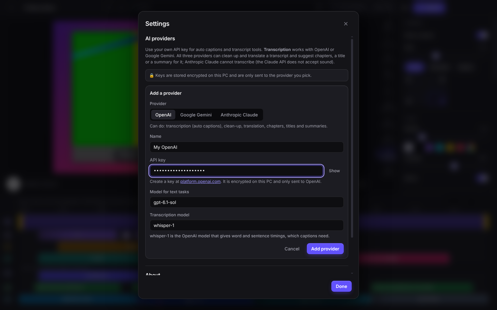
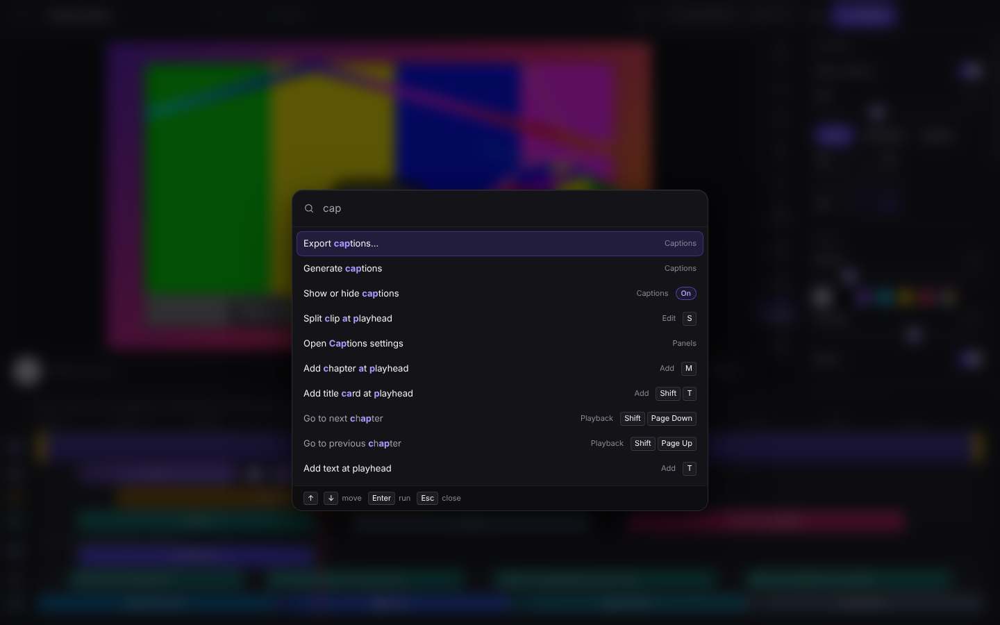
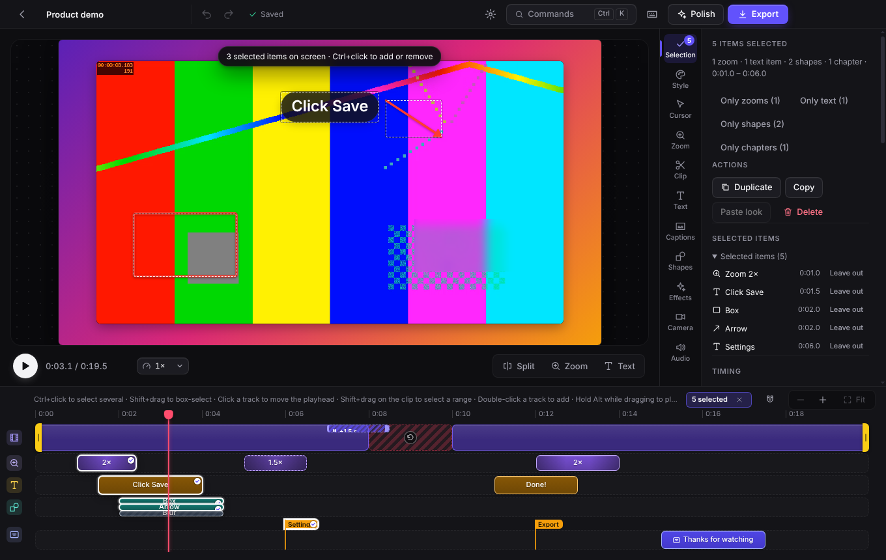

# Flown

Flown — a Windows screen recorder and editor by Qbexel ([qbexel.com](https://qbexel.com)): record your
screen, then get a polished video with **automatic zoom on clicks**, a **smooth cursor**, **motion
blur**, beautiful **backgrounds**, a **webcam bubble**, **text and keystroke overlays**, and fast
**MP4 / GIF export**.

Built with Electron, React and TypeScript, small Rust helpers for Windows capture and for speech on
the PC (whisper.cpp and Silero VAD), and ffmpeg.

- [Feature list](docs/FEATURES.md): everything the app does, and what is still on the roadmap
- [Implementation](docs/IMPLEMENTATION.md): architecture and design decisions
- [Building](docs/BUILDING.md): toolchain, installer, icon and code signing
- [Native capture helper](native/README.md): the Windows Graphics Capture recorder and its manual test checklist
- [Research](docs/RESEARCH.md): the macOS recorder that inspired it, and how others approached it
- [Roadmap](docs/ROADMAP.md): researched future features, ranked, with what each AI provider can do

## Features

| | |
| --- | --- |
| **Record** | A full screen, an **area** you drag out, or a single window · microphone · system audio · webcam · **recording presets** · 3-2-1 countdown · floating control bar (pause / resume / stop / discard) · custom hotkeys (stop, pause, zoom here) · 30/60 fps · auto-pause when idle · hide desktop icons · camera preview · **live camera bubble** while you record (kept out of the video; drag it or snap it to a corner, and the edit follows it) · recording bar with mute, hide camera, pause, restart, discard and stop · recordings are streamed to disk while you record, so nothing is lost if something crashes |
| **No double cursor** | On Windows 10 2004+/11 screens, areas **and single windows** are recorded by a native helper (Windows Graphics Capture, GPU H.264) that leaves the Windows cursor out of the video, so the app can draw its own smooth cursor. Elsewhere it falls back to Chromium capture automatically |
| **Windows too** | Recording a single window keeps every cursor effect: the cursor and clicks are mapped into the window as it moves or resizes, so auto zoom, click ripples and (with native capture) the smooth cursor all work. Without native window capture the app still follows the window for auto zoom and ripples, with the Windows cursor left in the video |
| **Motion** | Auto zoom from your clicks, typing and "zoom here" marks, which zooms out while a page scrolls and back in where it stops · ignore stray clicks · straighten wobbly cursor moves · region zoom · pull back · zoom easing and connected pans · camera follows the cursor with spring smoothing · motion blur on zooms and pans · **3D tilt** · typing zoom that holds while you type · smooth, resizable cursor that keeps the real cursor shape (arrow, text, hand, …) or a style of your choice (macOS, Windows, white, black, custom image) · highlight halo · ripple / ring / pulse clicks with optional click sound · tilt, trail, loop home · hide cursor when idle |
| **Edit** | **Polish in one click** (style, auto zoom, silences, captions and camera in one undo step) · Undo / redo · **crop the recording** after recording · **freeze frame** · audio waveform and **snapping** on the timeline · `J` / `K` / `L` and 0.5×–2× preview speed · trim, split, cut and speed (0.25×–8×) per clip · **smart speed** for idle stretches and **remove silences** · **title cards** and **chapters** (written into the file, copyable as YouTube timestamps) · zoom segments (level, follow cursor or fixed point picked on the preview) · text annotations · keystroke overlay for shortcuts (`Ctrl + C`, never plain typing) · **shapes** (arrows, boxes, ellipses, highlighter) · **privacy blur / pixelate** that follows zooms · **spotlight** · **command palette** (`Ctrl+K`) and **custom shortcuts** · webcam position, size, shape, border, mirror, framing, **background blur** (offline) · **camera layouts** over time (camera only, side by side, large camera) · aspect ratios (Auto, 16:9, 9:16, 1:1, 4:3) · zoomable timeline for long recordings · auto-save |
| **Style** | Gradients, colour, image, 16 generated **wallpapers**, blurred and **animated** backgrounds · **device frames** (browser, laptop, monitor, phone) · padding, corners, borders (incl. glass), soft / hard / glow shadows · **watermark or logo** · 8 built-in **style presets** plus your own · **save your look as the default** for new recordings |
| **Captions** | **Free captions on this PC** with word timings: no key, no upload (a Whisper model, 60 MB for Standard, downloaded once after a click that names its size) · or **auto captions** from your own OpenAI or Gemini key · both for long recordings too · transcript editor · AI **clean-up, translate, chapters, title and summary** (OpenAI, Gemini or Claude) · caption styles (clean, bold, boxed, **karaoke**, minimal), position, size, colours, lines · right-to-left languages · their own timeline track · burned into the export, or **SRT / VTT / text** files that follow your cuts |
| **AI keys** | Add OpenAI, Gemini or Claude in **Settings** with your own API key and test it · keys are encrypted with Windows' data protection, stay in the app's main process and are never shown again · Claude handles the text tools (it cannot transcribe audio) |
| **Audio** | Separate microphone and system-sound tracks with their own volume · noise reduction · even out loudness · fades · **background music** that lowers itself while you talk · a built-in **speech detector** so remove silences, smart speed, music ducking and the camera director hear your voice, not your typing · master volume / mute |
| **Export** | Destination presets (YouTube, X, LinkedIn, Reels, TikTok, Shorts, Slack, email) · batch export · target file size · MP4 / MOV / WebM / GIF / M4A · PNG thumbnail · MP4 (H.264/AAC) 720p → 4K at 30/60 fps using the GPU when available (WebCodecs, NVENC, Quick Sync, AMF), with software fallback · palette-optimised GIF · exact frames and colours · progress with ETA · **Copy** the exported file to the clipboard to paste into chat apps or Explorer |

## Screenshots

Taken from the built app with seeded projects (`SSW_UI_SHOTS=docs/screenshots` with
`tests/e2e/ui.e2e.cjs`, and with `tests/e2e/multi-select.e2e.cjs` for the multi-selection).

| | |
| --- | --- |
|  |  |
| **Home**: pick a screen, window or area; recent recordings | **Editor**: background, padding, corners and shadow in the Style tab |
|  |  |
| **Captions**: generated captions on their own track, styles and position | **Camera**: webcam bubble and camera layouts over time |
|  |  |
| **Export**: destination presets, format, resolution and quality | **Settings**: your own OpenAI, Gemini or Claude key for captions and transcript tools |
|  |  |
| **Command palette** (`Ctrl+K`): every editor action by name | **Select several items**: move them together and edit what they share, with *Mixed* where they differ |

## Getting started

Requirements: Windows 10 (2004+) or 11 to run the app; Node.js **20.19+ or 22.12+** to build it.

```bash
npm install
npm run dev        # run the app with hot reload
npm test           # unit tests
npm run typecheck
npm run dist:win   # build the Windows installer: dist/Flown-Setup-<version>.exe
```

End-to-end tests drive the built app with Playwright. On Linux run them under a virtual display:

```bash
npm run build && xvfb-run -a -s "-screen 0 1920x1080x24" npm run test:e2e
```

### Building the installer

`npm run dist:win` works on Windows, Linux and macOS (Linux/macOS need Wine). It checks its inputs
first (fetching the Windows `ffmpeg.exe` when cross-building), builds the native capture helper when
a Rust toolchain is available, and verifies the package afterwards. See
[docs/BUILDING.md](docs/BUILDING.md).

### Code signing

The installer is unsigned until you add a certificate, so Windows SmartScreen warns on first launch
("More info" → "Run anyway"). Signing switches on automatically when the environment (or a
git-ignored `electron-builder.env`) provides one of:

- a `.pfx` file: `CSC_LINK` + `CSC_KEY_PASSWORD`;
- a certificate in the Windows store (USB token / EV): `WIN_SIGN_CERT_SHA1` or `WIN_SIGN_CERT_SUBJECT`;
- Azure Trusted Signing: `AZURE_TRUSTED_SIGNING_ENDPOINT`, `_ACCOUNT`, `_PROFILE`, `_PUBLISHER`
  plus Microsoft Entra credentials (`AZURE_TENANT_ID`, `AZURE_CLIENT_ID`, `AZURE_CLIENT_SECRET`).

Set `SSW_REQUIRE_SIGNING=1` for release builds so an unsigned build fails. Full instructions:
[docs/BUILDING.md](docs/BUILDING.md#code-signing).

## Using it

Recordings are stored in `Videos\Flown\<recording>` as `project.json`,
`cursor.json` and H.264 proxies of the screen and camera. Unfinished recordings (for example after a
crash) are listed on the home screen and can be recovered.

### Editor shortcuts

These are the defaults; every one can be changed in the Shortcuts dialog (`Ctrl+/`).

| Key | Action |
| --- | --- |
| `Space` | Play / pause |
| `J` / `K` / `L` | Play backwards / pause / play forward (press `J` or `L` again for 2×, 4×, 8×; hold `K` and tap `J` / `L` to step one frame) |
| `<` / `>` | Slower / faster preview speed (0.5×–2×; the export is not affected) |
| `←` / `→` | Step 1/30 s |
| `Shift+←` / `Shift+→` | Back / forward one second |
| `Home` / `End` | Go to the start / end |
| `S` | Split the clip at the playhead |
| `C` | Crop the recording (`Enter` applies, `Esc` cancels) |
| `F` | Freeze the frame at the playhead |
| `R` | Hold the view here (a video that follows the action keeps its view still) |
| `G` | Show or hide where TikTok, Reels and Shorts put their buttons and captions (tall frames, preview only) |
| `Z` | Add a zoom at the playhead |
| `1`–`4` / `0` | Set the selected zoom's level (1.25×, 1.5×, 2×, 3×) / pull back to 0.75× |
| `T` | Add text at the playhead |
| `Shift+T` | Add a title card at the playhead |
| `M` | Add a chapter at the playhead |
| `Shift+PageDown` / `Shift+PageUp` | Next / previous chapter |
| `Shift+P` | Polish in one click |
| `Ctrl+K` (`Ctrl+Shift+P`) | Command palette: search and run any command |
| `Ctrl+E` | Export |
| `Ctrl+/` | Shortcuts: rebind any command, reset to defaults |
| `Delete` / `Backspace` | Delete the selection (clip → cut, zoom, text, freeze frame, or a Shift-dragged range), or every selected item |
| `Ctrl+Z` / `Ctrl+Y` (`Ctrl+Shift+Z`) | Undo / redo |
| `+` / `-` (`=` / `_`), `Ctrl`+wheel | Zoom the timeline in / out |
| `N` | Snapping on / off (hold `Alt` while dragging to place an item freely) |
| `Esc` | Clear the selection, cancel the crop tool, or close the export dialog |
| Double-click a zoom or text track | Add a zoom / text there |
| `Shift`+drag on the clip track | Select a range to cut or re-time |
| `Ctrl`+click / `Shift`+click | Select several items / a run of items on one track |
| `Shift`+drag on a track | Select the items in a box (`Ctrl`+drag adds to the selection) |
| `Ctrl+A` | Select all items on the track you last used (again: every item) |
| `Ctrl+C` / `Ctrl+X` / `Ctrl+V` | Copy / cut / paste items (pasted at the playhead; the items stay in Flown, not in the Windows clipboard) |
| `Ctrl+D` | Duplicate the selected items right after themselves |
| `Ctrl+Shift+C` / `Ctrl+Shift+V` | Copy one item's look / paste it onto the selected items |

## How it works (short version)

1. **Capture.** On Windows the native helper (`ssw-capture.exe`) records the monitor with Windows
   Graphics Capture, without the cursor, straight to a GPU-encoded MP4, while Chromium records only
   the audio. Otherwise Chromium's `getDisplayMedia` records video and audio. Everything is streamed
   to disk as it is recorded. The main process samples the cursor, clicks and shortcut keystrokes.
2. **Processing.** ffmpeg turns the recording into a 60 fps short-GOP H.264 proxy (on the GPU when
   possible, cropped for area recordings), and auto zoom segments are generated from click clusters.
3. **Editing.** One canvas compositor, a pure function of time, draws background, the
   rounded/shadowed recording, zoom camera with motion blur, smooth cursor, ripples, webcam, text and
   keystrokes. Cuts and speed changes are a list of clips; everything else stays in recording time.
4. **Export.** The same compositor renders every output frame. Frames are decoded in order with
   WebCodecs and encoded on the GPU (WebCodecs or ffmpeg's NVENC / Quick Sync / AMF), falling back to
   x264; audio follows the cuts and speed changes. The file is written to a temporary name and only
   moved into place when complete.

## Verification status

- Unit tests (vitest) cover the pure engine, timeline, export/proxy arguments, recording maths,
  native client protocol and packaging rules. End-to-end tests drive the real built app (recording
  with fake devices and real X11 input, editor flows, frame-accurate export, A/V sync after edits,
  colour accuracy, cancel safety, clipboard, motion blur and overlays, packaging).
- **Not yet verified on a real Windows PC:** Windows Graphics Capture in the native helper, GPU
  encoders (NVENC / Quick Sync / AMF / Media Foundation), system-audio loopback, the mouse and
  keyboard hook on Windows layouts, mixed-DPI multi-monitor setups, the PowerShell clipboard copy,
  and the installer UI. For smarter auto zoom: mouse-wheel notches from precision touchpads and
  high-resolution wheels, button releases (`mouseup`) while the native helper runs, and wheel
  positions on mixed-DPI setups. The native helper has a manual checklist in [native/README.md](native/README.md).

## Known limitations

- Window recordings need the native helper (Windows) to follow the window. Without it (or on other
  platforms) the window is recorded with no cursor data, so add zooms manually. Native window
  capture (no Windows cursor in the video) needs Windows 10 2004+; older versions still get auto
  zoom and click ripples, with the Windows cursor in the video.
- Noise reduction is applied on export only; the preview plays the unprocessed sound (the Audio tab says so).
- Area recordings capture the whole monitor and crop it afterwards.
- Code signing needs your own certificate (see above).
